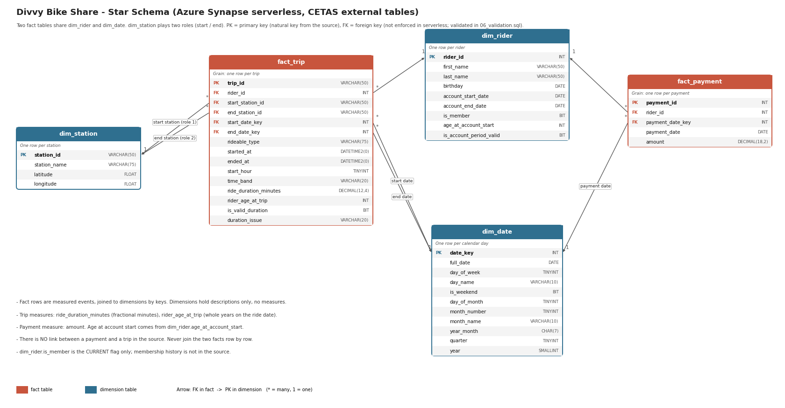

# Divvy Bike Share Data Warehouse on Azure Synapse

A dimensional data warehouse for Chicago's Divvy bike-share, built end to end on Azure with **PostgreSQL, Synapse Analytics (serverless SQL), and CETAS**. It turns 4.6M trips and 1.9M payments into a star schema that answers questions about ride duration and spending.

> Built for the Udacity Data Engineering with Azure program. Ride data is real (City of Chicago); rider, account and payment data is synthetic.



## What it does

```
CSV files --> Azure PostgreSQL (OLTP source, 4 tables)
          --> Synapse Ingest (one-time copy)      -> 4 text files in Data Lake   [EXTRACT]
          --> 4 x CREATE EXTERNAL TABLE           -> staging over the files      [LOAD]
          --> 5 x CETAS (Parquet)                 -> dim_* and fact_* tables     [TRANSFORM]
          --> SQL validation + business queries
```

The built-in **serverless** pool has no storage of its own, so nothing is "created" the usual way: external tables are schemas over files, and `CREATE EXTERNAL TABLE AS SELECT` writes each result to new Parquet files.

## Star schema

| Table | Grain | Highlights |
|---|---|---|
| `fact_trip` | one row per trip (4,584,921) | `ride_duration_minutes` (fractional), `rider_age_at_trip`, two station keys (start/end), `time_band`, duration quality flag |
| `fact_payment` | one row per payment (1,946,607) | `amount DECIMAL(18,2)`, rider and date keys |
| `dim_rider` | one row per rider (75,000) | `age_at_account_start`, current membership flag |
| `dim_station` | one row per station (838) | one dimension, used for both start and end roles |
| `dim_date` | one row per day (3,300) | continuous range built from the data itself |

## Interactive dashboard
`dashboard/index.html` is a single self-contained file (no server, no libraries). Open it in a browser, or serve it with GitHub Pages.
- One rider-type filter (all, members, casual) drives every chart.
- Tabs:
  - **Ride time:** weekday-by-hour heatmap, monthly trend, age, commute pattern (weekday vs weekend), ride-length distribution, bike-type mix by month.
  - **Stations:** map of 760+ stations (start or end role) and a ranking with a minimum-rides slider.
  - **Flow & routes:** where bikes pile up or run short (net arrivals minus departures per station), a rebalancing watch list, and the most common point-to-point and round-trip routes.
  - **Money:** yearly and monthly collections, spend per rider by age at account start, members vs casual.
  - **Riders:** accounts opened and closed per year, and active accounts over time.
  - **Usage vs spend** and **Pipeline & checks.**
- Each panel states its main finding in a sentence that updates with the filter.
- Headline numbers, age bands, spend and usage-vs-spend are the Azure query results. The heatmap, monthly, map and trend views are computed from the same source files with the same rules (`dashboard/build_data.py`).
- To rebuild: `python3 dashboard/build_data.py <folder with the four CSVs>` then `python3 dashboard/make_dashboard.py`.

## Decisions I'd defend in an interview
- **Two fact tables, never joined row by row.** A payment has no trip ID. Joining them would repeat each payment once per ride. The extra-credit analysis sums each side to rider-month first.
- **Correct ages.** `DATEDIFF(year)` alone is wrong before a birthday. I subtract 1 if the birthday hasn't happened yet. Leap-day birthdays count as 28 Feb (SQL Server's behaviour), which affects exactly one trip.
- **Bad data is flagged, not deleted.** 116 negative, 81 zero and 1,277 over-24h durations stay in the fact table with a `duration_issue` flag, so counts reconcile with the source.
- **Staging as text.** The Copy activity quoted strings, added `.0000000` to timestamps and exported money as `9.00`. Dates and money are staged as `VARCHAR` and parsed deliberately.
- **Re-run safety.** `DROP EXTERNAL TABLE` leaves CETAS files behind, so each run writes to a new `run01`, `run02`, ... folder.
- **Natural keys.** Source IDs are unique and stable, and serverless has no identity columns. Station IDs stay text (`KA1503000012`).

## Verification
- A one-table scorecard (`sql/warehouse/06_validation_summary.sql`) runs 26 checks: row counts, duplicate keys, orphan foreign keys, duration issues, total payment amount ($19,457,105.25) and hand-checked ages. **All 26 pass.**
- The business query results were recomputed independently in Python from the raw CSVs. They match, apart from one explained leap-day case and a few rider-months at band edges (ride minutes are stored to 4 decimals).

## What the data shows (synthetic, so treat as a demo)
- Weekend midday rides are longest (about 25-26 min vs about 18 on weekdays); weekday mornings are shortest (about 13 min).
- Age and member vs casual barely change ride length (about 19.3-20.4 min).
- Payments grow every year, from $53.7k (2013) to $6.08M (2021).
- Riders who ride more do **not** pay more. The synthetic data has no usage-based pricing, and many rides fall outside account dates. I report it rather than force a story.

## Run it yourself
1. Create an Azure Database for PostgreSQL and a Synapse workspace with Data Lake storage.
2. Create the tables (`sql/postgres/create_tables.sql`) and load the four CSVs from `./data`. `starter/README.md` explains how to get Udacity's loader script and what I changed in it.
3. Ingest the four `public.*` tables to the lake as text files with **no header**.
4. In a serverless database, run `sql/00_external_objects.sql` (edit the storage account and container), then `sql/staging/*.sql`, then `sql/warehouse/01` to `05`, then `06` and `07`.

Never commit credentials. The raw data is not included (about 500 MB).

## What went wrong, and how I fixed it
- The Ingest wizard's default storage connection failed with `AuthorizationPermissionMismatch`. The lab account couldn't assign roles, so I created a second linked service using the storage account key. External tables and CETAS used my signed-in identity, which worked.
- My own expected values came from profiling the CSVs before building anything. The first mismatch I found (age bands, off by one ride) turned out to be a leap-day birthday rather than a bug.

## Repo layout
```
README.md           this file
docs/               rubric checklist and the notes written for the course submission
sql/                00_external_objects, postgres/ (tables and source checks), staging/, warehouse/ (CETAS, validation, business queries)
dashboard/          interactive dashboard (index.html) and the scripts that build it
diagram/            star schema source (Python) and PDF
evidence/           screenshots from the real Azure run
starter/            how to load the source data (the course loader script is not redistributed)
tests/              local consistency check (no Azure needed)
```

## Credits and licence
- Ride data: City of Chicago, Divvy trips. Rider, account and payment data is synthetic (provided by the course).
- The loader script and the dataset belong to Udacity and are not included.
- My code, SQL, diagrams and write-ups are under the MIT licence (`LICENSE`).
