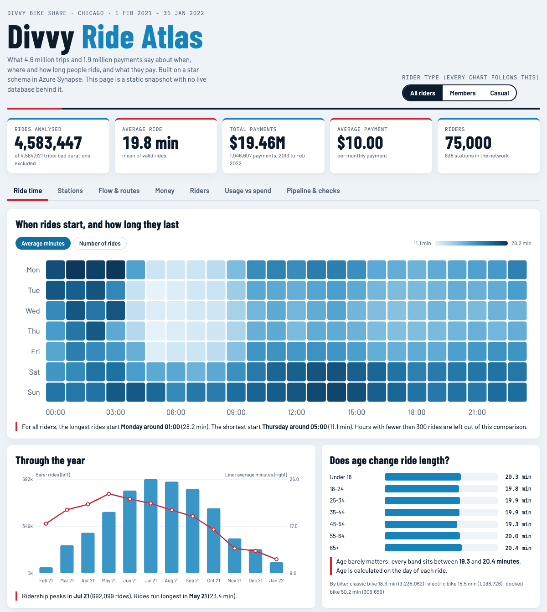
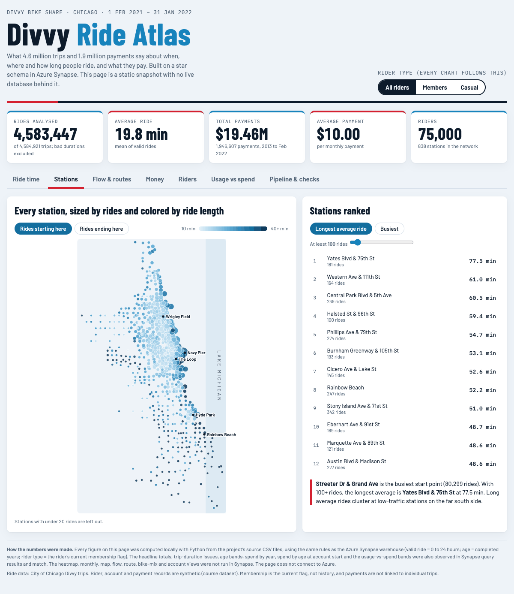
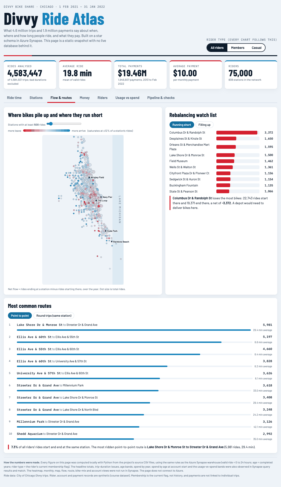
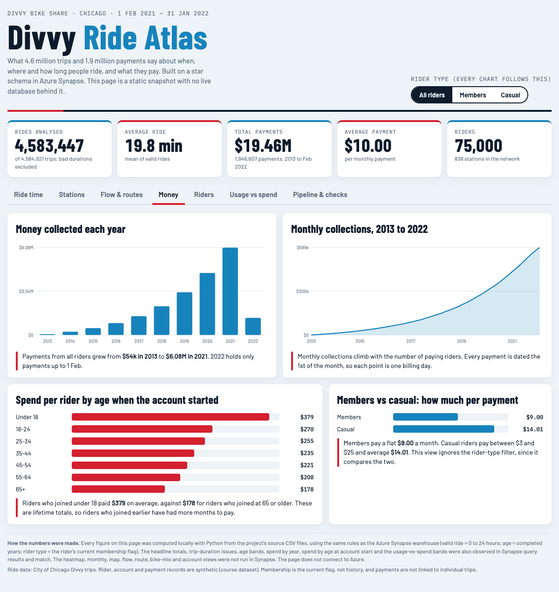
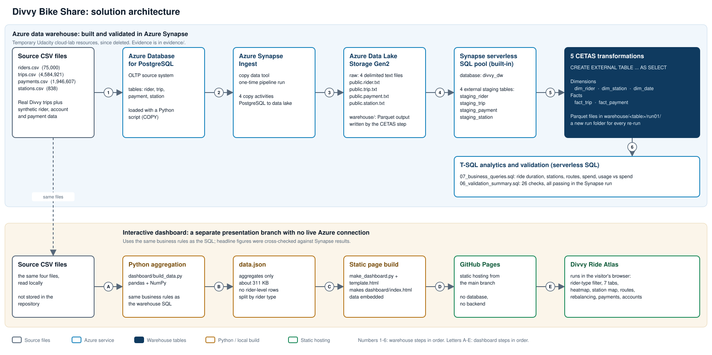
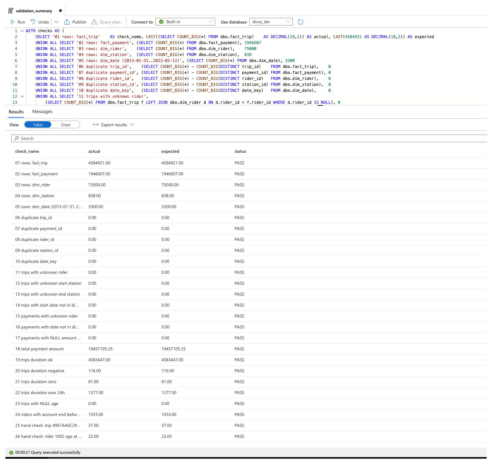

# Divvy Bike Share | Azure Data Warehouse & Analytics

A dimensional data warehouse for Chicago's Divvy bike share, built on Azure and validated with 26 automated checks, plus an interactive dashboard on top of the same analysis.

Divvy publishes millions of trips, but the raw files cannot answer simple questions: when are rides shorter, which stations have the longest rides, does age matter, and what do riders pay? I loaded the data into PostgreSQL, moved it through Azure Synapse and Data Lake Storage, and modelled it as a star schema with two fact tables and three dimensions, using external tables and CETAS on the serverless SQL pool. The warehouse covers **4.6 million trips and 1.9 million payments**.

**Technologies:** Azure Database for PostgreSQL · Azure Synapse Analytics (serverless SQL, copy pipeline) · Azure Data Lake Storage Gen2 · CETAS and Parquet · T-SQL · Python (pandas, NumPy) · HTML, CSS and JavaScript

## Interactive dashboard: Divvy Ride Atlas

[](https://adebowalep.github.io/divvy-azure-data-warehouse/dashboard/)

**[Open the live dashboard](https://adebowalep.github.io/divvy-azure-data-warehouse/dashboard/)**. One rider-type filter (all, members, casual) drives every chart. Seven views: ride time, stations, flow and routes, money, riders, usage vs spend, and pipeline and checks. Each panel states its main finding in a sentence that updates with the filter.

This is a **static snapshot**. It does not connect to Azure (the Azure resources were temporary and are deleted). Its numbers were computed from the source CSV files with the same rules as the warehouse SQL; [which views were also observed in Synapse](docs/validation.md#what-the-dashboard-shows-and-where-each-view-comes-from) is documented.

<table>
<tr>
<td width="33%" valign="top"><a href="docs/images/dashboard-stations.png"></a><br><sub>Stations: map and ranking</sub></td>
<td width="33%" valign="top"><a href="docs/images/dashboard-routes.png"></a><br><sub>Flow and routes: rebalancing, routes</sub></td>
<td width="33%" valign="top"><a href="docs/images/dashboard-money.png"></a><br><sub>Money: payments by year, month, age</sub></td>
</tr>
</table>

## Key results

| | |
|---|---|
| Trips | 4,584,921, of which 4,583,447 have a valid duration (0 to 24 hours) |
| Payments | 1,946,607, totalling $19,457,105.25 |
| Riders and stations | 75,000 riders, 838 stations |
| Warehouse | 2 fact tables, 3 dimensions, 5 CETAS transformations, Parquet output |
| Validation | 26 of 26 checks passing in Azure Synapse |

The ride data is real (City of Chicago, Divvy). The rider, account and payment data is **synthetic**, created for the course, so payment findings describe this dataset and not real customers.

## Solution architecture



The top row is the Azure warehouse: four CSV files go into PostgreSQL, a one-time Synapse pipeline copies them to Data Lake Storage as text files, the built-in serverless SQL pool exposes them as four external staging tables, and five CETAS statements write the star schema as Parquet. T-SQL queries and a validation scorecard run on top. The bottom row is a separate branch for the dashboard, with no live link to Azure. The diagram is editable: [docs/architecture.drawio](docs/architecture.drawio).

## Dimensional model


| Table | Grain |
|---|---|
| `fact_trip` | one row per trip: `ride_duration_minutes`, `rider_age_at_trip`, start and end station keys, start and end date keys, duration flag |
| `fact_payment` | one row per payment: `amount`, rider key, payment date key |
| `dim_rider`, `dim_station`, `dim_date` | one row per rider, station and calendar day; `dim_station` serves both the start and the end of a ride |

Also as a [PDF](diagram/star_schema.pdf). The model is defined once in [diagram/schema_spec.py](diagram/schema_spec.py), and a test checks the SQL against it.

## ELT workflow

1. **Source.** Four tables in Azure PostgreSQL: `rider`, `trip`, `payment`, `station` ([definitions](sql/postgres/create_tables.sql), [source checks](sql/postgres/validate_source.sql)).
2. **Extract.** A one-time Synapse copy pipeline writes four text files to the data lake.
3. **Load.** Four [external staging tables](sql/staging/) read those files. Dates and money stay as text until the transformation.
4. **Transform.** Five [CETAS scripts](sql/warehouse/) build the dimensions first, then the facts, as Parquet in `warehouse/<table>/run01/`.
5. **Validate.** A [scorecard](sql/warehouse/06_validation_summary.sql) of 26 checks.
6. **Analyse.** [Business queries](sql/warehouse/07_business_queries.sql) for ride duration, stations, spend, and rides vs spend.

## Engineering decisions

- **Separate fact tables.** A payment has no trip id. Joining payments to trips would repeat each payment once per ride, so the two facts are only combined after both are summed to rider and month.
- **Correct ages.** Completed years, not a plain year difference (which is wrong before the birthday). A 29 February birthday counts as 28 February in non-leap years, the same as T-SQL `DATEADD`.
- **Data-quality flags, not deletion.** 116 negative, 81 zero and 1,277 over-24-hour durations stay in `fact_trip` with a flag, so the warehouse row count equals the source. Reports filter on the flag.
- **Safe re-runs.** Dropping an external table does not delete its files, so every re-run writes to a new `runNN` folder in all five scripts.
- **Natural keys.** The source ids are unique and stable and serverless SQL has no identity columns. Station ids stay text (`KA1503000012`). Key integrity is checked by queries because external tables do not enforce keys.
- **Current membership only.** `is_member` is a current flag with no history, so member vs casual means current status.

More detail and the reasons: [docs/implementation-notes.md](docs/implementation-notes.md).

## Data quality and validation

[](docs/validation.md)

The scorecard compares the warehouse with values profiled from the source files before anything was built: row counts, duplicate keys, orphan keys, parse failures, the payment total, duration categories and two hand-checked ages. All 26 pass. [docs/validation.md](docs/validation.md) separates what was **observed in Azure** from what was **computed locally**, and records the discrepancies I found by recomputing the dashboard figures independently (a leap-day birthday that moved one ride between age bands, and an active-account count that included invalid accounts). Both were fixed. The 39 Azure screenshots are indexed in [evidence/](evidence/README.md).

## What the data shows

| Finding | Source |
|---|---|
| Weekend midday rides are longest (Saturday 25.0 min, Sunday 26.1) against 18.1 to 18.9 min on Tuesday to Thursday | Synapse |
| Weekday mornings are shortest, about 12.7 to 13.9 min | Synapse |
| Age and rider type barely matter: 19.3 to 20.4 min across age bands, members 19.87 and casual 19.76 | Synapse |
| Payments rise every year, from $53.7k in 2013 to $6.08M in 2021 | Synapse |
| Riders who joined under 18 paid $379 on average, riders who joined at 65 or older $178 (lifetime totals, so earlier joiners have had longer to pay) | Synapse |
| Riding more does not mean paying more ($5.90 to $6.96 per active month from 1 ride a month to 11 or more) | Synapse |
| Members pay a flat $9.00 a month; casual payments average $14.01 | computed locally |
| Electric bikes grew from 17% of rides in February 2021 to 31% in January 2022 | computed locally |
| Some stations steadily lose bikes (for example Columbus Dr & Randolph St, net minus 3,372 over the year) | computed locally |

Because the payment data is synthetic, none of this should be read as operational advice or as evidence of causes.

## Dashboard implementation

SQL warehouse (Azure) → the same four CSV files → [build_data.py](dashboard/build_data.py) (pandas) → [data.json](dashboard/data.json) (aggregates only, about 310 KB, no rider-level rows) → [make_dashboard.py](dashboard/make_dashboard.py) with [template.html](dashboard/template.html) → one static [index.html](dashboard/index.html) → GitHub Pages. The Azure warehouse and the dashboard share business rules, not a connection. There is no server and no framework, and the page loads fonts from Google Fonts and nothing else. [tests/smoke_dashboard.py](tests/smoke_dashboard.py) drives it in a real browser at desktop, tablet and phone widths (84 checks).

## Reproducibility

- **Dashboard:** `python3 dashboard/make_dashboard.py` rebuilds `index.html` from the committed data. Rebuilding `data.json` needs the four source CSV files, which are not in this repository (they belong to the course).
- **Warehouse:** needs an Azure subscription (PostgreSQL, Synapse with Data Lake Storage) and the same CSV files, and has no one-click deployment. The steps, settings and cost notes are in [docs/reproduction.md](docs/reproduction.md).
- **Checks:** `python3 tests/check_project.py` needs only Python and no Azure.

## Project structure

```
README.md  LICENSE  requirements.txt  requirements-dev.txt
index.html  .nojekyll        GitHub Pages: redirect to dashboard/
dashboard/                   index.html, template.html, data.json, build_data.py, make_dashboard.py, capture_screenshots.py
sql/                         00_external_objects.sql, postgres/, staging/, warehouse/ (CETAS, validation, queries)
diagram/                     schema_spec.py, star-schema PDF/PNG and generator, make_architecture.py
docs/                        architecture.drawio, implementation-notes.md, validation.md, reproduction.md, portfolio-summary.md, images/
evidence/                    screenshots from the Azure run, with an index
starter/                     how to load the source data (the course loader script is not included)
tests/                       check_project.py, smoke_dashboard.py
```

## Limitations and data provenance

- **Mixed data.** Real Divvy trips with synthetic riders, accounts and payments.
- **Temporary environment.** The Azure resources were a time-limited cloud lab and were deleted afterwards; the evidence is recorded screenshots and results.
- **No live database.** The dashboard is a static snapshot and does not query Azure.
- **Source data not included.** The course data files are not in the repository, so the warehouse cannot be rebuilt from a fresh clone alone.
- **Membership** is the current flag, not history. **Payments** are not linked to trips. Many trips fall outside their rider's account dates; that is a property of the synthetic data, and the trips are kept.

## Documentation

[Implementation notes](docs/implementation-notes.md) · [Validation](docs/validation.md) · [Reproduction](docs/reproduction.md) · [Portfolio summary](docs/portfolio-summary.md) · [Evidence index](evidence/README.md)

## Credits and licence

Ride data: City of Chicago, Divvy trips. The data files and the loader script come from the Udacity "Data Engineering with Azure" program and are not included here. My code, SQL, diagrams and writing are under the [MIT licence](LICENSE).
